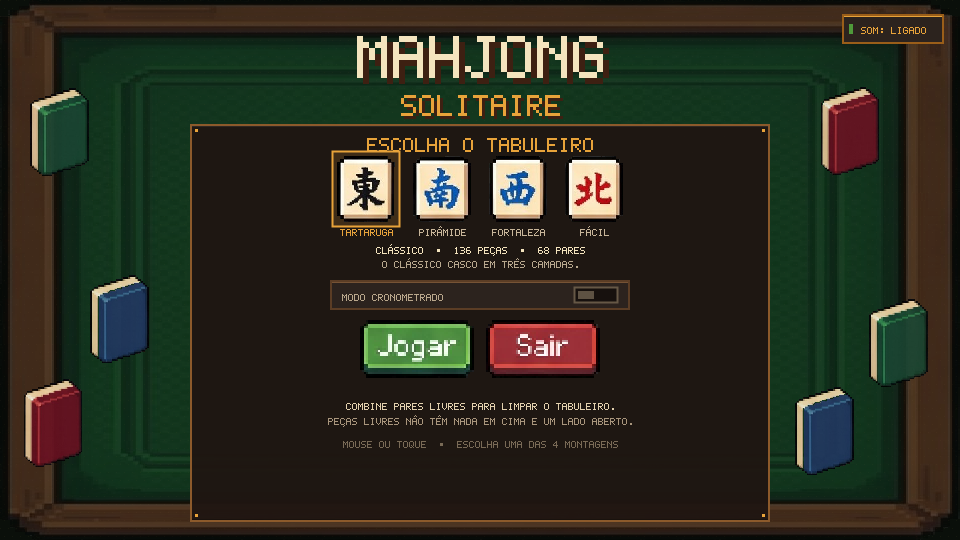
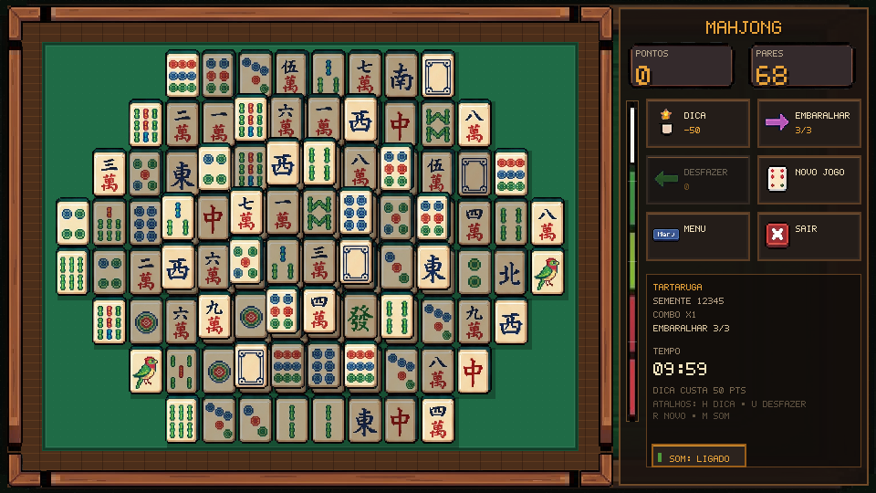

# Mahjong Solitaire — Pixel Art

Jogo completo de **Mahjong Solitaire** para navegador, em HTML5 + Canvas 2D +
JavaScript puro (ES modules), com interface em português do Brasil. Não usa
frameworks, bundler nem dependências de rede. Toda a arte visual vem dos
sprites extraídos das folhas em `assets/raw/`.





## Como rodar

```bash
# na raiz do projeto
python3 -m http.server 8000
# abra http://localhost:8000
```

> É necessário usar um servidor HTTP. Abrir `index.html` com `file://` bloqueia
> o `fetch()` do atlas e dos PNGs.

Requisitos apenas para **regenerar sprites/testar**: Python 3, Pillow, numpy,
scipy e Node.js. O jogo em si não tem dependências.

## Como jogar

- Combine dois pares do **mesmo tipo** (por exemplo, dois 5 de Bambu).
- Só é possível remover peças **livres**: sem nenhuma peça sobreposta em uma
  camada superior e com pelo menos um lado (esquerdo ou direito) vazio.
- Peças bloqueadas aparecem escurecidas. Ao clicar em uma, o cadeado aparece.
- Complete o tabuleiro para vencer.

### Controles

| Ação | Mouse/toque | Teclado |
|---|---|---|
| Selecionar/remover par | clique/toque | — |
| Dica | botão **Dica** | `H` |
| Embaralhar | botão **Embaralhar** | — |
| Desfazer | botão **Desfazer** | `U` |
| Novo jogo | botão **Novo Jogo** | `R` |
| Menu | botão **Menu** | `Esc` |
| Som | botão **Som** | `M` |
| Iniciar no menu | botão **Jogar** | `Enter` |

O canvas tem resolução lógica fixa de **960×540** e é ampliado por escala
inteira (2×, 3×…). Em janelas menores que a resolução lógica, a página reduz o
canvas com vizinho mais próximo para caber; em celulares na horizontal a
experiência fica proporcional. Em retrato, aparece um aviso para girar o
aparelho.

## Funcionalidades

- 4 layouts: **Tartaruga** (136 peças), **Pirâmide** (136), **Fortaleza** (136)
  e **Fácil** (48).
- Geração sempre resolvível por remoção reversa de pares livres.
- Baralho de 34 tipos × 4 cópias = 136 peças. Nos layouts menores são usados
  subconjuntos de tipos, sempre com 2 pares (4 cópias) por tipo.
- Seed reproduzível e exibida no HUD.
- Modo cronometrado opcional, com bônus por tempo restante, sino de alerta nos
  últimos 10 s e barra vertical que esvazia de cima para baixo.
- Combos por pares em menos de 3 s, dica com custo de 50 pontos, 3
  embaralhamentos por partida e desfazer ilimitado.
- Efeitos de quebra, poeira/estrelas/faíscas, molduras, cadeados e chuva de
  estrelas na vitória.
- Áudio sintetizado com WebAudio (sem arquivos externos), com botão de mudo e
  persistência em `localStorage`.

### Partida reproduzível

O seed é mostrado no HUD. Também é possível iniciar diretamente por URL:

```text
index.html?layout=tartaruga&seed=12345&tempo=1
```

`layout` aceita `tartaruga`, `piramide`, `fortaleza` ou `facil`. `tempo=1`
ativa o modo cronometrado. O seed também é aceito pelo gerador em Node:

```js
import { LAYOUT_BY_ID } from './src/layouts.js';
import { generateBoard } from './src/generator.js';
const board = generateBoard(LAYOUT_BY_ID.tartaruga, 12345);
```

## Testes

O teste prova que 1.000 seeds de **cada** layout são resolvíveis por simulação,
valida pares, cópias por tipo e ainda testa 50 embaralhamentos por layout:

```bash
node tests/rules.test.js          # 1.000 seeds por layout
node tests/rules.test.js 200      # amostra menor, útil durante o desenvolvimento
```

Resultado esperado no final:

```text
OK  TARTARUGA   1000/1000
OK  PIRÂMIDE    1000/1000
OK  FORTALEZA   1000/1000
OK  FÁCIL       1000/1000
OK  ... 50/50 embaralhamentos
TUDO OK: todos os tabuleiros gerados são 100% resolvíveis.
```

## Regenerar os sprites

```bash
python3 tools/slice_sprites.py
```

O pipeline:

1. detecta a moldura xadrez e remove o fundo por flood-fill;
2. usa alpha proporcional à distância do cinza para efeitos sem contorno;
3. detecta componentes conectados, agrupa partículas por dilatação e descarta
   ruído de JPEG;
4. recorta e nomeia 90 sprites;
5. grava `assets/sprites/*.png`, `assets/atlas.json` e
   `assets/debug_contact_sheet.png`.

Para conferir o resultado, abra [assets/debug_contact_sheet.png](assets/debug_contact_sheet.png):
cada célula traz o nome do sprite e as dimensões. O atlas contém
`{x,y,w,h,source,file}` de cada sprite.

### Aviso importante sobre os arquivos de origem

As folhas recebidas estavam com dois nomes trocados em relação ao briefing:

- `assets/raw/Flores.jpeg` contém, na verdade, as **7 honras**
  (東 南 西 北 中 發 + Dragão Branco).
- `assets/raw/ventos_e_dragoes.jpeg` contém, na verdade, os **9 caracteres**
  (一萬 … 九萬).

O pipeline detecta o conteúdo pela contagem de peças e emite os avisos, mas os
arquivos físicos mantiveram os nomes originais. Os sprites foram gerados com
os nomes corretos (`tile_char_*`, `tile_wind_*`, `tile_dragon_*`). Não foi
inventada nenhuma arte.

A linha de UI foi extraída somente de `assets/raw/dots.jpeg`, como pedido.

### Corrigir nomes no atlas

Se um recorte ficar com nome errado, a forma mais segura é ajustar a lista de
nomes do pipeline em `tools/slice_sprites.py` (função `extract_tile_sheet`) ou
o bloco de regiões de UI/efeitos; depois rode o pipeline novamente. Se você
editar `assets/atlas.json` manualmente, mantenha as chaves `x,y,w,h,source,file`
e recarregue a página. O código cliente lê o nome diretamente das chaves do
atlas.

### Contagem por grupo no pipeline

```text
tile: 34 (char 9, bamboo 9, dot 9, honras 7)
back: 3
locked: 3
icon: 5 (lock, 2 checks, 2 X)
frame: 3
break: 4
fx: 6
arrow: 5
hint_frame: 1
ui: 26
total: 90 sprites
```

## Estrutura

```text
index.html                 entrada
style.css                  fundo, canvas nítido, aviso de retrato
tools/slice_sprites.py     pipeline de fatiamento
assets/raw/                folhas originais
assets/sprites/            um PNG RGBA por sprite
assets/atlas.json          mapa dos sprites
assets/debug_contact_sheet.png
src/main.js                bootstrap, escala, mouse/toque
src/game.js                fluxo, pontuação, entrada, efeitos
src/layouts.js             os 4 layouts em meia-célula
src/rules.js               tipos, ocupação, peça livre
src/generator.js           geração reversa resolvível + shuffle
src/render.js              desenho do jogo/HUD/efeitos
src/ui.js                  geometria clicável
src/assets.js              carregamento do atlas e cache
src/audio.js               sintetizador WebAudio
src/font.js                fonte bitmap 5×7 com acentos pt-BR
tests/rules.test.js        testes de solvabilidade
```

## Placeholders / arte faltante

**Nenhum.** Todos os 90 sprites usados vêm das folhas fornecidas. Se algum
arquivo for removido do atlas, o carregador exibe um placeholder roxo listrado
e registra o nome em `assets.placeholders()` no console; nesse momento a lista
de faltantes será mostrada ali.

Textos, dígitos do contador, molduras de foco internas e a textura de feltro
são desenhados por código (fonte bitmap/fillRect), como pedido — não são arte
externa.

## Notas de implementação

- `imageSmoothingEnabled = false` no canvas lógico e nos canvases de cache.
- A camada de peças e o cenário estático são cacheados; apenas molduras,
  efeitos e HUD são redesenhados a cada frame.
- Uma peça é bloqueada por qualquer peça ativa em camada superior que a
  sobreponha, não apenas pela camada imediatamente acima.
- A geração reversa retira pares de peças livres do estado atual; a sequência
  resultante é uma solução completa. Embaralhar repete o processo apenas nas
  posições restantes.
- O botão **Sair** tenta fechar a aba; navegadores só permitem isso em algumas
  situações. Quando o fechamento é bloqueado, é exibida a tela “Até logo” com
  opção de voltar ao menu.
- O áudio só é inicializado depois de um gesto do usuário, respeitando as
  políticas de autoplay dos navegadores.
