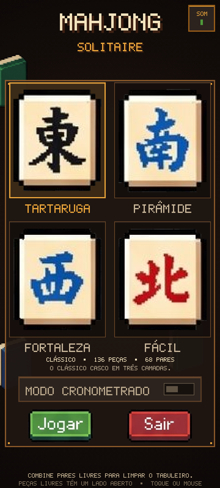
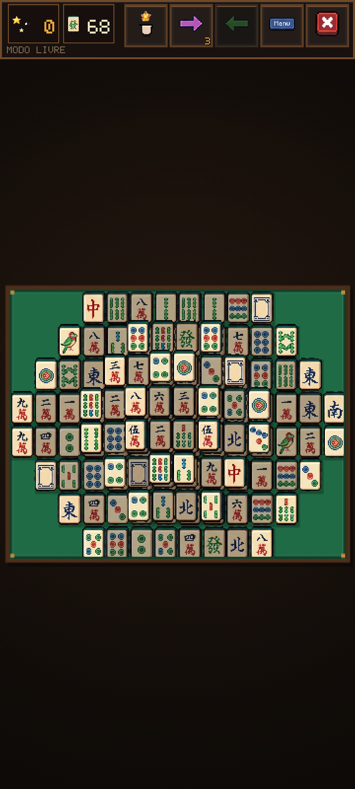
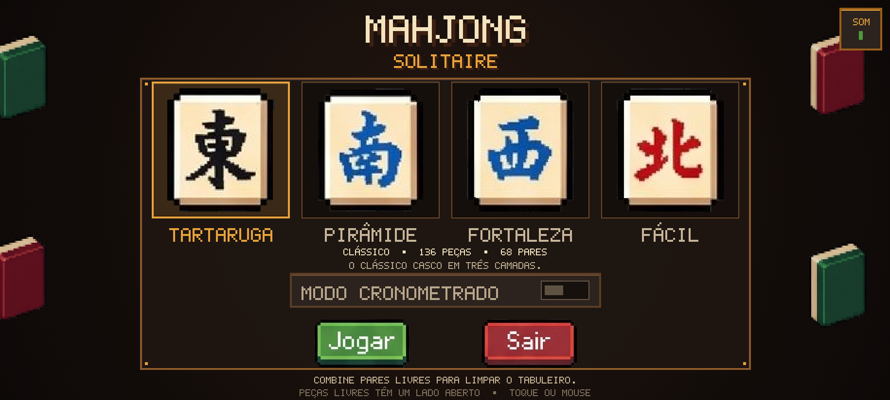
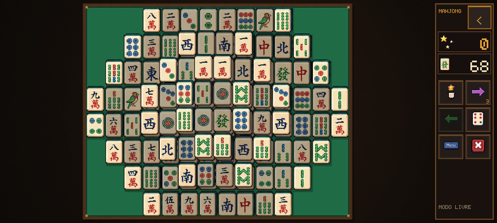
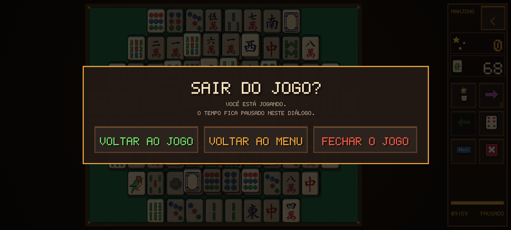

# Testes responsivos

Capturas geradas com Playwright/Chromium em modo móvel (toque, DPR 2). Cada
tamanho tem o menu inicial e uma partida com o layout Tartaruga (136 peças).

| Viewport | Modo | Peça (CSS px) | Cartão do menu | Resultado |
|---|---|---|---|---|
| 360×800 | retrato | 24,4×34,1 | 158×190 | todas as peças dentro da tela |
| 412×915 | retrato | 28,0×39,2 | 158×190 | todas as peças dentro da tela |
| 800×360 | paisagem compacta | 30,1×42,2 | 142×89 | todas as peças dentro da tela |
| 915×412 | paisagem compacta | 34,6×48,5 | 142×141 | todas as peças dentro da tela |
| 1280×720 | desktop / painel completo | 61,3×85,8 | 190×210 | todas as peças dentro da tela |

Em todos os tamanhos não houve erro de console, requisição falha, peça cortada
nem rolagem da página. O tabuleiro usa a maior escala possível dentro da área
disponível, descontando margens e `safe-area-inset-*`.

## Fluxos testados

- Recolher/reabrir o painel compacto em paisagem, com a preferência salva em
  `localStorage` (`mahjong-pixel-hud`).
- Diálogo de saída com três opções: **Voltar ao jogo**, **Voltar ao menu** e
  **Fechar o jogo**.
- Timer pausado enquanto o diálogo está aberto e retomado ao voltar ao jogo.
- `window.close()` bloqueado no navegador exibindo a mensagem para fechar a aba.
- Botão voltar do Android (tratado no código) abrindo o mesmo diálogo durante a
  partida e uma confirmação de saída no menu.
- Troca de paisagem para retrato sem reiniciar a partida (136 peças preservadas).
- Área segura simulada (`--safe-top`, `--safe-left`, `--safe-right`) aplicada ao
  tabuleiro e ao painel.
- Tela final com botões dentro do painel.

## Arquivos

- `menu-360x800-portrait.png` / `game-360x800-portrait.png`
- `menu-412x915-portrait.png` / `game-412x915-portrait.png`
- `menu-800x360-landscape.png` / `game-800x360-landscape.png`
- `menu-915x412-landscape.png` / `game-915x412-landscape.png`
- `menu-1280x720-desktop.png` / `game-1280x720-desktop.png`
- `exit-dialog-landscape.png`, `exit-dialog-portrait.png`
- `menu-exit-portrait.png`, `collapsed-hud-safe.png`, `end-desktop-safe.png`

